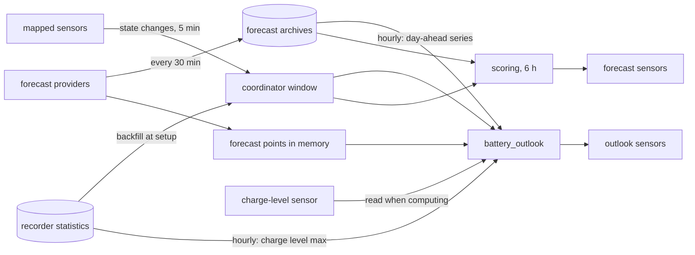

# Solar Sanity: architecture

A map of the repository for someone who has to change it. It covers:
- what each top-level folder is for;
- how the integration runs inside Home Assistant;
- how the battery outlook is computed and graded;
- how the persistent store is provisioned;
- how build, test, lint and release work;
- the biggest risks.

Rewritten for 0.30.0, when the battery outlook replaced the energy-balance check. The
history of the check lives in git and in `CHANGELOG.md`, not here. Line numbers are left
out on purpose; names are given instead, because names survive edits.

Repository identity: the GitHub remote is `fadmaz/ha-solar-sanity` and the integration
domain is `solar_sanity`. The local directory name `ha-smart-solar-manager` is a leftover
from before the domain was renamed, and it appears nowhere in the code.

---

## 1. What this is, in one screen

A Home Assistant custom integration that learns how a house uses energy and projects where
its battery is heading. Five sensors are read off one projection of the charge, an hour at
a time, from now to the end of the forecast:
- **battery full at** (`battery_full_at`);
- **battery reaches reserve at**, before the sun (`battery_reserve_at`);
- **lowest battery before sunrise** (`battery_lowest_before_sunrise`);
- **safe average load tonight** (`safe_average_load`);
- **spare solar** (`spare_solar`).

Beside them sits the **forecast archive**. Each selected solar forecast provider is recorded
as it is issued, in two external statistic series: a rolling one, and a write-once day-ahead
one. The day-ahead series is scored against what the roof produced
(`forecast_bias_<provider>`), and the battery outlook learns its forecast scale from it.
`expected_tomorrow_corrected` and five more corrected sensors (power now, this hour, the next
hour, the rest of today, today) are the provider's own figures moved by that scale, or by a
stated score where there is no battery. No uncorrected figure is published: the provider's
sensors already are one.

A Lit card renders the outlook (`solar-sanity-battery-card`), and another renders tomorrow's
current forecast from the rolling series, with what the roof is expected to make of it
(`solar-sanity-forecast-card`).

Two design rules shape everything:
- **No answer is an unknown with a reason, never a guess.** A missing hour is never read as
  a quiet one, an absent sensor is never read as zero, and every outlook sensor without a
  figure carries a `reason` attribute in a sentence.
- **Everything published can be graded.** A day-ahead forecast is written once and never
  revised, so it can be scored. The diagnostics download carries the window, the charge
  level history and the forecast archive, so `scripts/backtest_outlook.py` can replay every
  night against what the battery really did. Changing a threshold without replaying is how
  the previous product was wrong for weeks without anyone noticing.

The arithmetic lives in `analysis/`, which is pure: no Home Assistant import, standard
library only, deterministic. `tests/analysis/test_purity.py` enforces it with an AST walk.

---

## 2. Top-level layout

| Path | What it is |
| --- | --- |
| `custom_components/solar_sanity/` | The integration. `analysis/` inside it is the pure package. |
| `frontend/src/` | The Lit card source, TypeScript, built by Vite into `custom_components/solar_sanity/frontend/` (git-ignored). |
| `frontend/dev/harness.html` | Renders the cards on synthetic data in a browser. Not in the bundle. |
| `tests/` | `analysis/` and `unit/` are pure; the top-level `test_*.py` files are meta and contract tests; `integration/` needs Home Assistant; `synth/diagnostics.py` reads a diagnostics download back into buckets. |
| `scripts/` | `check.py` (every gate in CI order), `check_size.py` (bundle budget), `backtest_outlook.py` (grade the outlook against a real download), `make_brand_assets.py`. |
| `diagnostics/` | Git-ignored. Real downloads go here and never into git: they carry a house's entity ids and a month of its consumption. |
| `.github/workflows/` | `validate.yml` (every push and pull request, and Mondays) and `release.yml`. |
| `AGENTS.md` | Instructions for any coding agent: commands, conventions, gotchas, the maintainer's standing instructions and the reference installation. `CLAUDE.md` imports it; `.gemini/settings.json` and `.aider.conf.yml` point Gemini CLI and Aider at it. |
| `docs/OPEN_THREADS.md` | Where the work stands: threads left open, with their evidence. |

---

## 3. Runtime architecture

### 3.1 Module map, in reading order

| Module | Role |
| --- | --- |
| `__init__.py` | Setup: restore, backfill, first refresh, the three timers, the one-off cleanup of what the energy-balance check left, platform forwarding, the `rescore_forecasts` service. |
| `coordinator.py` | `DataUpdateCoordinator[None]`. Owns the measurement window (hourly buckets from its own integrator, seeded from the recorder), the forecast capture, the scores, and the window's save and restore. Its refresh only scores forecasts. |
| `battery_outlook.py` | The outlook's Home Assistant side. It reads the charge level when computing (never at setup) and doubts a stale one. It picks a fresh forecast and scales it, learns the scale from the recorder once an hour, and keeps published times steady. |
| `analysis/outlook.py` | The pure projection: steps, simulation, night window, safe load, publishing rules. |
| `analysis/profile.py` | What the projection learns from the window: hour-of-day profiles, the charging ceiling, grid-charged hours, the inverter's standby draw, and the forecast scale. |
| `analysis/forecast.py`, `scoring.py` | Day-ahead forecast scoring: the pure estimator and its Home Assistant side. |
| `analysis/model.py`, `analysis/linalg.py` | The shared shapes (`Role`, `Quality`, `BucketSource`, `ChannelSpec`, `Bucket`) and the six numeric helpers the above use. |
| `statistics_source.py` | Every recorder read and write: backfill queries, the two forecast archives, the hourly charge-level read, and provider discovery and fetch (with the Forecast.Solar period-start re-key, 3.7). |
| `_forecast_plan.py` | Pure rules for the archive: what is eligible for the day-ahead series, the write plan, running totals, and `by_period_start`. |
| `config_flow.py`, `discovery.py`, `_match.py`, `_identity.py` | The wizard, reconfigure and options. Discovery ranks candidate sensors per role from the Energy Dashboard and the states; identity refuses a second entry for the same house. |
| `sensor.py`, `entity.py` | The entities. One device per config entry. |
| `diagnostics.py` | The download: entry, archive status, coverage, window, outlook, 32 days of charge level, both forecast archives. |
| `frontend.py` | Serves the built card and registers it as a Lovelace resource (5.7). |
| `_local_time.py` | Local day and DST resolution per hour, never by a fixed offset. |

### 3.2 Data flow



### 3.3 Config entry lifecycle

`async_setup` (once per start):
1. Registers the card (`frontend.async_register`).
2. Registers `rescore_forecasts`.
3. Runs `_async_retire_the_check`, which deletes every Repairs issue of this domain and
   removes the old shared `solar_sanity.state` file.

Both are safe to repeat.

`async_setup_entry`, in this order (the order is the mechanism):
1. `coordinator.async_restore()`: the saved window, so measured hours win over re-derived
   ones.
2. `_async_backfill`: 30 days of statistics. `ingest_backfill` skips any hour already
   present. Classification asks the recorder, not the state machine, because MQTT-bridged
   inverters publish after Home Assistant starts.
3. `async_config_entry_first_refresh()`: scores the providers. It never raises.
4. The timers (3.4) and the power and charge-level subscriptions.
5. One immediate forecast capture, then `battery.refresh(force=True)`, so the outlook
   sensors are born with a projection or a reason.
6. `_remove_retired_entities`: the five entities of the retired check, by
   `(platform, f"{entry_id}_{key}")`, before the platforms load.
7. Forward to the `sensor` platform.

`async_remove_entry` removes the entry's state file.

No config-entry update listener exists anywhere. Combining one with
`async_update_reload_and_abort` or `OptionsFlowWithReload` is an error from 2026.12, and CI
greps for it.

### 3.4 The cadences

| Every | Timer | What runs |
| --- | --- | --- |
| state change | `async_track_power` | Close elapsed hours first, then integrate power over the durations held. |
| 30 s | `LIVE_INTERVAL` | `battery.refresh()`, which recomputes only if the charge level changed; then `notify_live_entities()`. |
| 5 min | `BUCKET_INTERVAL` | `accumulate()`: energy counters are differenced, and the hour closes on the boundary. Then `battery.refresh(force=True)` and `notify_live_entities()`. |
| hour close | `_close_bucket` | The bucket is stamped with `Quality` and `BucketSource`, then the window is saved (5.4). |
| 30 min | `FORECAST_CAPTURE_INTERVAL` | `async_capture_forecasts` writes both archives and holds the points in memory. `battery.async_learn()` re-learns the forecast scale at most once an hour. |
| 6 h | `SCORING_INTERVAL` | The coordinator refresh: `async_score_providers`. |

`notify_live_entities` is `async_update_listeners`. It is how every sensor is rewritten,
because `CoordinatorEntity` writes only on a coordinator update and the refresh is six-hourly.

`_advance_hour` is shared by state events and sampling. It settles each boundary
before a new value can cross it, and closes delayed hours individually. Energy
channels are differenced only for `total` and `total_increasing`. Other energy
classifications are excluded, with a warning on entry into that condition and a
`reason` in coverage diagnostics; arrival of a valid cumulative state recovers it.

Every function handed to a timer or a listener is `async def` or `@callback`. Home Assistant
runs anything else in a worker thread, where `async_write_ha_state` raises for a custom
integration. The two ticks above were plain functions until 0.31.1: the outlook was computed
every five minutes, and its sensors were written only at setup and by the six-hourly refresh.
`tests/test_event_loop_callbacks.py` walks the source for it.

### 3.5 Entities and the honesty rules

- Unique ids are `f"{entry.entry_id}_{key}"`.
- Sensors:
  - `expected_tomorrow_corrected`, `TOTAL`, so the forecast is recorded. It corrects the
    first provider with a figure for tomorrow and no other, by the learned factor for
    tomorrow first and a stated score second (`analysis.forecast.correction`), and says
    which in its attributes: `provider`, `forecast_statistic_id`, `factor`, `basis`, `days`,
    or `reason` while unknown. The uncorrected `expected_tomorrow` was retired in 0.33.0
    (`RETIRED_ENTITIES`);
  - five `solar_*_corrected` sensors, created when a provider is configured, with no
    `state_class`: Forecast.Solar's power now, this hour, next hour, remaining today and
    today, as this roof would make them (`analysis.forecast.roof_forecast`, fed by
    `coordinator.roof_forecast`). Today's factor, from the same provider. No corrected peak
    time: one factor for a day cannot move its peak;
  - one `forecast_bias_<provider>` per configured provider, created because the provider is
    configured, not because a figure exists yet;
  - the five outlook sensors (see 1), and three more since 0.34.0:
    `battery_usable_energy` (`ENERGY_STORAGE`, `MEASUREMENT`: the one outlook sensor that
    is a measurement), `expected_use_tonight`, and `spare_solar_power`, which is worked on
    every write from the live readings (`OutlookSensorDescription.live_fn`) rather than
    from the last refresh;
  - `battery_lowest_before_sunrise` carries `power_sources`, the entity ids of the power
    sensors the card shows live: mapped channels that report power, and the optional
    `OPT_BATTERY_POWER` with its sign. Ids only; the card reads the states itself.

The outlook sensors:
- **When they exist.** They are created when `entry.options` holds both a charge-level
  sensor and a capacity, never on live state.
- **Unavailable and unknown.** They are unavailable only while the charge level is not
  readable. Otherwise a sensor with no answer is unknown, with a `reason` attribute,
  because unavailable hides attributes.
- **No `state_class`.**
- **Unrecorded attributes.** `trajectory`, `soc_pct` and `computed_at` are kept out of the
  recorder.
- **What the card reads.** `battery_lowest_before_sunrise` carries everything the card
  draws: the trajectory, the starting charge, the reserve and target, the night window, the
  forecast scale and the inverter's standby.
- **The lowest-battery percentage** has no `battery` device class, so automations never
  read a forecast as the charge now.

### 3.6 Config flow and discovery

**The wizard:**
1. **Channel mapping.** It is pre-filled by `discovery.async_discover`, which ranks
   candidates with reasons and demotes a net battery sensor named after both directions.
   Consumption and generation are required.
2. **Overlap warning,** if another entry already watches a channel.
3. **Providers and battery size.** One step offers the forecast providers and, if a
   charge-level sensor was picked, the capacity, reserve and target. It is skipped when
   there is neither.

Reconfigure repeats steps 1 and 3 and merges options by hand, because
`async_update_reload_and_abort(options=...)` replaces. The options flow offers the four
battery rows and clears only rows it rendered.

`CONF_` keys live in `entry.data` and `OPT_` keys in `entry.options`.
`tests/test_option_stores.py` walks the source for a key read from the wrong store.

Entries made before 0.30.0 still hold `has_battery`, `grid_is_net` and `load_whole_house`
in `entry.data`, and possibly `suppressed_codes`, `corrections` and `guaranteed_annual_kwh`
in `entry.options`. Nothing reads them. They are left in place so a rollback to 0.29 loses
nothing, and there is deliberately no config-entry migration.

### 3.7 Services and the forecast archive

**Services:** one, `rescore_forecasts` (`SupportsResponse.ONLY`).

**The two series per provider:**
- `solar_sanity:forecast_<entry id>` is rolling and idempotent.
- `solar_sanity:dayahead_<entry id>` is written once at 12 h or more of lead time.

**Recorder rules:**
- Entry ids are lower-cased, because the recorder refuses uppercase ULIDs
  (`tests/test_statistic_ids.py`).
- Only one entry owns a provider's archive.
- Metadata is `mean_type=StatisticMeanType.NONE`, `has_sum=True` and `unit_class="energy"`.
- CI greps for both metadata fields and forbids `async_add_external_statistics` outside
  `statistics_source.py`.

**Forecast.Solar timestamps.** Forecast.Solar keys each value by the **end** of its period.
Home Assistant re-keys it by period start only from 2026.11 (core PR 188790). On older
releases `async_get_solar_forecasts` applies the same rule (`by_period_start`) before
anything reads the payload, gated in `stamps_period_end`
(`tests/test_forecast_period_keys.py`). Rows archived before that fix are an hour late and
stay as written.

**Which series is honest.** The `latest` series for an hour that has passed holds the last
capture of that day. On the reference installation that capture was usually clear-sky-like,
not what any projection saw. Learn and grade from `dayahead` only.

---

## 4. The battery outlook

### 4.1 Contract

`analysis/` imports nothing from Home Assistant. It uses single-dot relative imports only, so
it loads both standalone and as `custom_components.solar_sanity.analysis`.

The standard-library allowlist is:
- `dataclasses`, `datetime`, `enum`, `math`, `typing`;
- `collections`, `__future__`, `abc`, `functools`, `itertools`.

It must not use the clock or randomness, and `x or 0` is banned. `test_purity.py` enforces
all of this.

### 4.2 The projection

`build_steps` makes hourly steps from now to the last forecast hour, at most 36:
- **The first step** is the rest of the current hour, at the rate measured so far
  (`open_hour_rates`) once it has been watched for 15 minutes.
- **Load** comes from the hour-of-day profile, keyed by local hour, as a mean over 14 days.
- **Production** comes from the forecast, scaled (4.3), keyed by UTC hour. Today and
  tomorrow are each scaled for the kind of day forecast (`BatteryOutlook.day_factors`).
  A day is judged by its whole total, from the current forecast for hours still to come
  and from the day-ahead archive for hours gone, never from the current forecast's
  rewrite of a passed hour (3.7). Hours missing
  inside the forecast's span count as zero, and the horizon ends at its last hour.

Without a forecast, the production profile (a median by UTC hour) answers the night
read-outs only. History on an inverter that cannot export is curtailed to what was used, so
it understates the sun by day.

**`simulate`:**
- A surplus charges at efficiency 0.95, at no more than the learned ceiling, up to the
  target. The rest spills.
- A deficit discharges at 0.92, down to the reserve. The rest is shortfall.
- The learned standby is added to the load at every step.
- Crossing times are exact within a step.
- "Full" means target minus one point.

### 4.3 What is learned from the house

| Figure | Where | From | Notes |
| --- | --- | --- | --- |
| Load profile | `hourly_profile` | 14 days of `load` buckets | Fewer than 3 samples in any hour means not ready, never zero. |
| Charging ceiling | `max_charge_w` | 30 days of `battery_charge` | 99th percentile; at least 20 hours of charging. |
| Grid charging | `grid_charged_hours` | 14 days | Disclosed only. The projection never counts it, because it answers "would the battery alone get me there". |
| Inverter standby | `standby_w` | Dark hours the battery carried alone | The median of `discharge × 0.92 − load`. About 92 W on the reference installation. An AC-side battery meter learns zero. |
| Forecast scale | `forecast_scale` | Day-ahead archive against `pv` buckets, over 14 days | Only hours more than 3 points below the target and without grid import count. At least 3 days, bounded to 0.1 to 2.0. About 0.4 to 0.5 overall on the reference installation. |
| Factor by the kind of day | `ForecastScale.for_day` | The same days, each with its whole day-ahead total | Each day weighted by `exp(-(ln(total ratio) / 0.6)²)`, plus half a day of the overall ratio. Today and tomorrow get their own; later days the overall one. On the reference installation about 0.43 for a 60 kWh day and 0.6 to 0.9 for a cloudy one. |

### 4.4 Read-outs and publishing

- **The night** (`night_window`) is anchored on darkness, judged from forecast or profile
  production and never the measured anchor, so a cloud at noon does not open one. It
  begins at the deficit run leading into the dark and ends at the takeover: the first later
  step where production covers the house load plus the inverter's standby.
- **The safe load** is bisected on shortfall ≤ 1 Wh, which is monotone in the load.
- **Tonight's use** (`Outlook.night_load_wh`) is the load plus the standby over the night
  window's steps, from its start or now until the takeover; none without a takeover.
- **Two figures about now** need no projection. `usable_energy_wh` is the charge above the
  reserve after the discharge efficiency. `spare_power_w` works one moment the way
  `simulate` works a step. The house and the standby come first, then the battery up to its
  ceiling, and the rest is spare. The production it starts from is the live measured one,
  unless the battery is full or charging at `CEILING_SHARE` of its ceiling: then an
  inverter with nowhere to send a surplus holds production down, so the higher of the
  measured and the corrected forecast (`roof_forecast().power_now_w`) stands. Held down
  with no forecast, there is no answer.
- **Times are published** rounded to 5 minutes, with a one-step hysteresis. A moment that
  has passed keeps its time.
- **A narrow miss holds the published time** (`settle_full`, `settle_reserve`). When the
  new estimate is gone or more than an hour later, a moment still ahead stays while the
  projection comes within 2 points of its line up to an hour past it: the full line, or the
  reserve. An earlier estimate always goes out at once. Without this, on 2026-11-09 the
  reference installation's "full at" swung between Monday 15:40 and Tuesday 12:20 four
  times in thirteen minutes, on a peak of 99.4 against the 99 line. One whole-percent step in
  the charge reading was enough.
- **The charge level is refused** if it is not numeric or not between 0 and 100. It is also
  refused if it is over 2 h old while the battery moved more than 2% of its capacity, or
  over 6 h old when complete usable history in both battery directions cannot
  establish quiet. Observed movement can reject a reading even with partial history.
- **A forecast is stale** after 3 h without a capture. The projection, all six
  corrected forecast sensors and the forecast input to live spare power share
  this rule. Corrected sensors carry a reason while unknown; learned factors
  and archive rows survive the outage.

### 4.5 Grading

`scripts/backtest_outlook.py diagnostics/<file>.json --tz <zone>` replays every evening (and
every morning for "full at") with profiles built only from earlier hours and the day-ahead
forecast. It grades against each hour's lowest and highest charge reading, not the mean. It
reports the night's lowest error, the reserve call, the reserve time, and the daytime fill
calls.

Every hourly minimum must exist for a night to count; mornings require every
hourly maximum through the observation window. Missing extremes do not fall
back to hourly means. CSV replays require both endpoints and no internal gap
longer than two hours. Incomplete intervals are reported separately.

Two options:
- `--period-end-before` re-keys a Forecast.Solar archive written before 2026.11 (3.7).
- `--raw` replays without the learned standby and scale.

**The gate.** The energy-balance check was deleted after this gate passed: at least 14
distinct nights, mean absolute lowest error ≤ 5 points, reserve called right ≥ 85%. On the
reference installation at 0.34.2 it passes on 29 nights with an error of 2.47
points, a bias of +0.1, and 78 of 85 reserve calls right.

---

## 5. How a store gets provisioned

"Store" is `homeassistant.helpers.storage.Store`: JSON under `.storage/`. Solar Sanity keeps
one per config entry, `solar_sanity.state.<entry_id>`.

### 5.1 Sequence

`SolarSanityCoordinator.__init__` builds the `Store` with no I/O. `async_restore` is the
first read, ahead of the backfill. The first write follows the first closed hour (5.4).

### 5.2 What is persisted

`_payload` returns `{"window": window_snapshot()}`. That is the columnar snapshot:
- `keys`, `quality_codes`, `source_codes`, `columns`;
- `rows` of `[start_utc, seconds, [wh...], quality chars, source chars]`.

It is unrounded, so a replay is exact. It runs to about 120 kB at the full window
(`MAX_BUCKETS = 24 * 45`). The same snapshot feeds the diagnostics download.
`tests/test_window_snapshot.py` pins the code tables against `tests/synth/diagnostics.py`.

### 5.3 Restore semantics

`_restore_from` catches every exception, logs a warning, and starts without the window. A
file from a newer release must cost the window, not setup: `Store` calls
`_async_migrate_func` when versions differ, and the default raises.

`_buckets_from_snapshot` refuses a damaged window whole rather than partly. Unknown keys are
ignored, so a file written by 0.29 or earlier, with `loss_model`, `last_status`,
`last_finding` and `retention_days`, still restores its window.

### 5.4 Save cadence

The only write is `self._store.async_delay_save(self._payload, SAVE_DELAY)` in
`_close_bucket`, with a 30 s debounce. A bound method rather than a value is passed, so the
deferred write, or the final write at shutdown, saves the window as it is then.

Saving used to happen only from the energy-balance check's six-hourly analysis. Saving from
a coordinator refresh would stop whenever nothing listens to the coordinator, so it is
saved where hours are made.

### 5.5 Versioning contract

`STORAGE_VERSION = 1` and `STORAGE_MINOR_VERSION = 1`. No `_async_migrate_func` exists.
`tests/test_storage_contract.py` holds the contract without Home Assistant:
- `HISTORICAL_STORAGE_VERSIONS` ends with the current pair, sorted and unique;
- once `STORAGE_VERSION` is not 1, `_async_migrate_func` must appear in `coordinator.py`.

**Removing a key at the same version is allowed.** Restore reads only `window` and has
always ignored unknown keys; 0.30.0 stopped writing four of them this way.

**Adding or reshaping a key that is read back** needs, in the same commit:
- the previous pair appended to `HISTORICAL_STORAGE_VERSIONS`;
- a fixture at the old pair in `tests/integration/test_storage_round_trip.py`;
- for a major bump, a `Store` subclass with `_async_migrate_func`.

### 5.6 Teardown

- **Unload:** platforms only; the file stays.
- **Reload:** a fresh coordinator re-reads the same file.
- **Remove:** `async_remove_entry` deletes the entry's file. Home Assistant preloads every
  `.storage` file at boot, so an orphan would cost every start.

### 5.7 The other registration: the card as a Lovelace resource

`frontend.async_register` serves the built `frontend/` directory as `/solar_sanity`. It then
upserts a Lovelace resource at `/solar_sanity/solar-sanity.js?v=<version>`:
- immediately if Home Assistant is running, otherwise on `EVENT_HOMEASSISTANT_STARTED`;
- with the version from the loaded integration's manifest, falling back to `"0.1.0"`.

It works in storage-mode Lovelace only; in YAML mode it logs the URL to add by hand. It
reads `resource_mode` or `mode`, because 2026.2 renamed the attribute, and it converges on
one resource entry by URL prefix. `tests/test_card_registration.py` covers it.

---

### 5.8 Issued prediction journal (0.35.0)

`journal.py` owns a separate `solar_sanity.outlook_journal.<entry_id>` Store,
version 1. Its envelope is independent of the measurement window's version 1.1.
It contains immutable issued records, settled outcomes, provider capture health,
the journal's creation instant and last checked instant. At most 180 records
and 90 days are retained. Unknown versions and malformed records disable journal
writes while leaving the file and the battery outlook alone.

The live and five-minute ticks schedule one journal task at a time. Only a real
projection computed during the five-minute 08:00/20:00 checkpoint window can be
captured. Repeated times and restarts cannot duplicate a local date/slot. An
outage is represented by missed slots after installation, not by backfilling
predictions. Frozen inputs include the exact simulation steps, battery settings
and corrected forecast. The model revision remains `baseline-0.34.2`.

After the recorded observation window ends, hourly charge extremes grade the
minimum or fill call. `analysis/observations.py` is also used by the historical
replay; `analysis/grading.py` reports explicit exclusions. Failed recorder reads
are distinct from empty history and retry for one day. Grid charging is screened
with the replay's existing rule. Fill-time error needs a real recorded crossing;
an hourly maximum never supplies invented minutes.

Provider health separates attempted, captured, submitted and verified timestamps.
The writer supplies its exact batches, then a background read-back tries at
5, 30 and 120 seconds. Matching rows attest to content, not a physical write
instant; exhaustion remains unverified. A no-op day-ahead append does not reset
its history. Unload cancels verification and journal tasks. Entry removal also
removes the journal. None of these paths change the projection or its constants.

Four descriptive sensors summarize 28 days, with a seven-day summary and counts;
they have no cumulative state class. Collection status and per-provider capture
and archive-verification timestamps expose operational evidence. Card discovery
continues to use stable registry translation keys rather than generated IDs.

---

## 6. The card

### 6.1 What ships

`frontend/src/main.ts` imports the editors and the strategy for their registrations, and
pushes two entries onto `window.customCards`: `solar-sanity-battery-card` and
`solar-sanity-forecast-card`.

**`solar-sanity-battery-card`** (`battery-card.ts`, logic in `battery-model.ts`):
- **Height.** Both cards return `rows: "auto"` from `getGridOptions`, so a sections
  dashboard gives them the height of their content. A fixed five rows let 0.34.0's
  second row of figures push the chart under the next card.
- **Live flow.** One line of solar, house, battery and grid power, read from the entities
  named in `power_sources`, in their own W or kW; a source not reporting is left out, and
  a battery under 20 W is idle.
- **Discovery.** It finds the outlook sensors through `hass.entities` by platform,
  translation key and device, never by entity id. With two installations it asks to be
  pinned (`device_id`) rather than guess.
- **The headline** is chosen from the projection's own night, takeover, full and reserve
  times, never from the browser's clock. Times are formatted in `hass.config.time_zone`.
- **The chart.** Its shapes are SVG, written with `svg` templates; its labels and dots are
  positioned elements, because text in a stretched SVG is squashed. Values are isolated with
  `<bdi>` for right-to-left dashboards.

**`solar-sanity-card`** is the retired status card's tag. It is kept as `SolarSanityLegacyCard`,
a subclass of the battery card, so dashboards built before 0.30.0 still render. It is not
offered in the picker, and it ignores the old `entity:` setting.

**`solar-sanity-forecast-card`** draws one SVG chart per provider of tomorrow's forecast,
with a hidden screen-reader table. The table sits in a hidden wrapper, because a table
ignores a 1-pixel width. Providers are found by their day-ahead archive, whose metadata
carries the name and whose id the `provider` option stores; the hours are read from the
same provider's rolling archive, which for tomorrow is simply the forecast as it stands.
Until 0.31.0 it drew the day-ahead rows, which for tomorrow are the first ones seen, about
two days old: 48.2 kWh beside a sensor reading 34.6. "Never `latest`" is a rule for hours
that have passed. When exactly one `expected_tomorrow_corrected` sensor names the same
rolling archive with a `factor`, the curve and the total are multiplied by it and the
uncorrected figure is not shown (0.33.0); otherwise the provider's forecast, and a line
saying it is not corrected. It reads again every 30 minutes, keeping what is
on screen meanwhile and through a failed refresh.

The forecast card's calendar and every hour label use `hass.config.time_zone`,
falling back to the browser only for an absent or invalid zone. Calendar-day
bounds are resolved as UTC instants rather than by adding 24 hours. Changing
the zone or day invalidates cached panels and discards an in-flight response
for the old question.

**Editors** wrap Home Assistant's `<ha-form>`: a device picker filtered to the integration,
and a provider picker read from `recorder/list_statistic_ids`.

**The strategy** (`ll-strategy-view-solar-sanity`, `ll-strategy-dashboard-solar-sanity`)
emits a battery card per installation with an outlook (one card when there is none) and
the forecast card.

### 6.2 The Python-to-TypeScript seam

| The card reads | From |
| --- | --- |
| Outlook sensors | `hass.entities[...]` with `platform == "solar_sanity"` and the literal translation keys in `sensor.py` |
| Trajectory, starting charge, reserve, target, night window | attributes of `battery_lowest_before_sunrise` |
| Full and reserve times | the states of `battery_full_at` and `battery_reserve_at` |
| Safe load, spare sun | the states of `safe_average_load` and `spare_solar`, with their `until` and `day_from` attributes |
| Forecast providers and their names | `recorder/list_statistic_ids`, the `solar_sanity:dayahead_*` ids |
| Tomorrow's forecast | `recorder/statistics_during_period` on the matching `solar_sanity:forecast_*` ids |
| What the roof makes of it | the `factor` and `days` attributes of `expected_tomorrow_corrected`, matched on `forecast_statistic_id` |

### 6.3 Build, serve, cache-bust

`npm run build` is `tsc --noEmit && vite build`: one ES2022 file, minified with Oxc, with a
source map, written into `custom_components/solar_sanity/frontend/`. `__SS_VERSION__` comes
from `manifest.json`, which is canonical. The `?v=` cache-buster comes from the same file,
so a version bump makes every browser refetch.

### 6.4 Tests and budget

Vitest under happy-dom, tests beside the code. They cover:
- discovery through the registry and the headline cases;
- the chart geometry, and that every chart element is in the SVG namespace;
- every card state, and the legacy tag;
- the forecast card's latch, half-hourly refresh and midnight roll;
- editor events escaping the shadow root.

`bundle.smoke.test.ts` loads the built file and checks the registered tags, the picker
entries and the absence of dynamic imports. It skips when no bundle is built.
`scripts/check_size.py` fails above 90 kB gzipped; the bundle is about 19 kB.

---

## 7. Build, test, lint, release

### 7.1 Test tiers

| Tier | Where | Needs Home Assistant |
| --- | --- | --- |
| Pure | `tests/analysis/` (`test_outlook`, `test_profile`, `test_forecast`, `test_purity`), `tests/unit/` | no |
| Meta and contract | `tests/test_*.py`, many behind `importorskip("homeassistant")` | partly |
| Integration | `tests/integration/` | yes; where Home Assistant does not install, it runs on CI only |
| Card | `frontend/src/*.test.ts` | no |

At 0.30.0 a machine without Home Assistant runs 232 Python tests and skips 9 modules; the card
has 139 tests. The `asyncio_mode` warning on such a machine is expected.

### 7.2 Local commands

```bash
python scripts/check.py
```

```bash
python -m pytest tests -q
```

```bash
npm ci && npm run lint && npm test
```

```bash
npm run build && python scripts/check_size.py
```

### 7.3 CI: `validate.yml`

Runs on every push, every pull request, and Mondays at 06:00 UTC.

| Job | What it does |
| --- | --- |
| `hassfest`, `hacs` | Upstream validation, floating on `@master` and `@main`. |
| `tests` | Python 3.13 and `requirements-dev.txt` (Home Assistant 2026.2.3); `pytest tests -q`. |
| `tests-floor` | The same suite at `pytest-homeassistant-custom-component==0.13.294` (Home Assistant 2025.11.0, the floor `hacs.json` declares). |
| `lint` | Unpinned ruff: `ruff check .` and `ruff format --check .`. |
| `deprecations` | Greps: external statistics only in `statistics_source.py`, with `mean_type` and `unit_class`; no `add_update_listener`; no `async_register_command` without `websocket_api`. |
| `card` | Node 22: `npm ci`, `npm run build`, `npm test`, `check_size.py`. |

### 7.4 Release: `release.yml`

It is triggered by a published release, or by `workflow_dispatch` with a tag to retry an
upload. Its steps:
1. Check out the tag.
2. Check the tag against `manifest.json`, then stamp it. A mismatch fails a published
   release and only warns on a retry.
3. Build the card.
4. Zip the component directory flat, as HACS unpacks it.
5. Attach the zip and `solar-sanity.js`.

`hacs.json` hides the default branch, where no built card exists.

### 7.5 Pins and version sources

`requirements-dev.txt` pins `pytest-homeassistant-custom-component==0.13.316`, which selects
Home Assistant 2026.2.3. The floor pin is in `validate.yml`.
`tests/integration/test_collection_guard.py` ties the running Home Assistant to the
`hacs.json` floor.

The version lives in `manifest.json` and nowhere else that matters. Its heading in
`CHANGELOG.md` must match (`tests/test_release_contract.py`).

---

## 8. The biggest risks

1. **The outlook has met one roof.**
   - The standby, the forecast scale and every threshold were measured on the reference
     installation: a DC-coupled hybrid, with no export, and Forecast.Solar.
   - Finished would be a second house's download replayed through `backtest_outlook.py`
     before any threshold moves.
2. **Provider timing is checked for Forecast.Solar only.**
   - A provider that keys by period end and is not re-keyed shifts every daytime read-out
     by an hour.
   - The backtest's `lag` line shows it: correlation should peak at zero.
3. **The `latest` archive misleads.**
   - For elapsed hours it holds the day's last capture, not what any projection saw.
   - Anything that learns or grades from it learns from hindsight, or from clear-sky
     figures (3.7).
4. **Daytime read-outs depend on the forecast's weather.**
   - The scale corrects an overestimate by the kind of day forecast, not a wrong day.
   - On the 2026-11-10 replay after excluding incomplete observation windows,
     "full at" misses six fill days and falsely predicts two, over 26 mornings.
     Only two correctly called fill days have complete observation windows;
     their median timing error is eight minutes late.
   - A provider whose forecast stops partway through tomorrow makes tomorrow look
     cloudier than it is. Its hours still to come are then scaled up.
5. **Card delivery rests on undocumented Lovelace internals** (`resource_mode`, the
   resources collection). A Home Assistant release can change them without notice.
6. **Side features fail into a debug log.** A forecast scale that cannot be learned, or a
   charge-level history that cannot be read, is logged at debug, so nothing on screen says
   the outlook runs unscaled.
7. **The product is English only by explicit choice.** Card text, dates and
   numbers stay English regardless of the Home Assistant user's language.
8. **Dead keys in older entries.**
   - `entry.data` and `entry.options` of entries made before 0.30.0 hold six keys nothing
     reads (3.6).
   - Reusing one of those names for something new would read an old answer as a new
     setting.
9. **A minor storage-version bump is unguarded.** Home Assistant accepts old data silently,
   so a minor bump that changes shape would ship undetected.
10. **`coordinator.py` is still the largest Python file,** and the one most changed.

---

## 9. Where to start reading

1. `analysis/outlook.py`: the whole projection, about 470 lines.
2. `analysis/profile.py`: everything learned from the house.
3. `battery_outlook.py`: how the projection meets Home Assistant.
4. `coordinator.py`, from `accumulate` to `_close_bucket`: how an hour is made.
5. `frontend/src/battery-model.ts`: what the card reads, and why.
6. `scripts/backtest_outlook.py`: how any of it is known to be right.

### English product interface and configuration Repairs (0.36.1)

Cards, editors, setup, entity labels, reasons and documentation are English
only. Card content stays left-to-right with English dates and number formatting,
independent of the Home Assistant user's language. User/provider names are not
translated. The obsolete card language field from 0.36.0 is ignored and removed
when the card is edited. Stable reason codes accompany compatible reason text.

`quality.ts` reads registry-discovered metric and health entities, scoped to the
battery device or forecast archive; it never grades observations in the browser.
`repairs.py` owns only non-cumulative energy configuration issues. The timer
reconciles these after sampling; recovery deletes the issue. Startup cleanup is
limited to retired check codes, and entry removal deletes only its own issues.
Missing data and insufficient calibration samples are not configuration Repairs.

### Silent daylight experiment (0.37.0)

`analysis/daylight_shape.py` learns a ratio for each third of forecast daylight,
using prior local days with valid measured PV and battery headroom. Each third
needs three distinct days. `ForecastScale.for_day` supplies the same similarity
weight and smoothing prior as the daily scale. The three ratios are normalized
so the corrected daily sum stays fixed. Missing internal forecast hours or
unproven daylight bounds retain the current distribution. HA's local sun helper
can independently establish the daylight window without storing coordinates;
explicit zero shoulders are the fallback when independent bounds are unavailable.

BatteryOutlook computes a shadow after the active baseline, with isolated failure
handling and its own settled times. The journal freezes and grades both. Shared
context and candidate revision prevent unlike configurations entering a paired
gate. `analysis/experiment.py` reports readiness only: no runtime promotion occurs.
A later reviewed change needs 14 new complete mornings and nights, no extra false
fills, fewer missed fills, no worse night error or reserve decisions, MAE <=5
points and reserve accuracy >=85%. Historical development replay cannot count.

The exact active corrected series is exposed to the forecast card as hourly
energy. Calculations retain the unrounded learned factor; the descriptive factor
stays rounded, with `applied_factor` available for reproducing the arithmetic.
The raw tomorrow total also retains precision until the corrected result is
rounded for publication; rounding it first once moved the sensor by 0.01 kWh
from its own hourly curve (0.39.1).
The curve attribute is excluded from recorder history. The active battery math
continues to be baseline-0.34.2 while prospective evidence accumulates.

### Frozen evening calibration (0.38.0)

`analysis/calibration.py` freezes an empirical signed-error interval with each
20:00 issue. For prediction-minus-actual residuals, the lower bound subtracts
q90 and the upper subtracts q10, clipped to physical percentages. Calibration
uses at most 60 valid earlier nights with the same baseline revision/context
and a recorded grading time no later than issue. This prevents future outcomes
or delayed recorder reads changing an already issued range.

After 30 calibration nights, limits are stored privately for silent validation.
Fourteen later completed issues with frozen limits must cover at least 80% of
actual minima. Until then (or if coverage is insufficient), public bounds stay
unknown with counts and a reason. The current night never validates itself.
The public view expires at the saved takeover boundary; old records without an
interval remain explicitly unrecorded. Calibration does not affect collection
health, Repairs, battery math or the current trajectory chart. The two rolling
percentage sensors have no cumulative state class.

### Comparable installation reports (0.39.0)

`scripts/evaluate_installation.py` takes one download and explicit installation
label/time zone. It fingerprints source bytes, separates provider/algorithm/
settings contexts and requires explicit timing verification before the night
accuracy gate can pass. Multiple providers require an explicit selection. No
learning or calibration is pooled across installations. Reports expose mapped
channel kinds and export presence without copying house entity IDs.

Historical 08:00/20:00 predictions use the shipping profile, scale, projection
and shared observation grader. Exact state histories alone can supply minute
errors; hourly extremes can grade fill occurrence only. Candidate development
comparisons use matched complete pairs with proven daylight coverage. Only
actual issued journal rows are passed to prospective gates, grouped by context
and revision. Historical replay cannot fabricate issued evidence.

The report always leaves generalization unproven pending independent provenance
review and an actual independent download. `--kind synthetic` is a testing label,
not evidence of another house. Synthetic real-HA tests exercise both power and
cumulative collection with and without export across time-zone/capacity variants
and clock changes. Counter cadence limits attribution precision; conservation
includes the current open bucket rather than discarding its pending increment.

Startup archive verification waits for HA's started event before its bounded
5/30/120-second read-backs. A slow unrelated integration can hold startup longer
than that entire retry period; exhausting retries before the recorder is ready
would leave healthy queued content marked unverified. Unload or a newer capture
cancels the old deferred callback/background task, including shared providers.
